# agy-ensemble — Workflow Autônomo de Engenharia em Fases & Orquestração Multi-Agente para Google Antigravity

> **Engenharia de Software Autônoma, Orientada a Documentação, Paralela e Auditável (`Etapa 0.0` → `Etapa 11`)**  
> O **`agy-ensemble`** unifica o rigor do planejamento estruturado em fases e documentação viva com a execução paralela de times de agentes isolados em worktrees (`Workspace: 'share'`), containers multi-tenant, cofre de segredos (**Vault / OpenBao**), **Compliance Obrigatório com a LGPD (Lei nº 13.709/2018)**, Quality Gates estáticos e dinâmicos (**SonarQube + Reports Nativos + SAST + DAST + PenTests**), telemetria **FinOps (`$ Estimado vs. $ Real`)** e o painel visual **Live Execution Trace Graph UI (*Mission Control*)**.

---

## Sumário

1. [Visão Geral e Arquitetura de Papéis](#1-visão-geral-e-arquitetura-de-papéis)
2. [Regras Pétreas e Invariantes Inegociáveis](#2-regras-pétreas-e-invariantes-inegociáveis)
3. [O Pipeline Unificado Fim a Fim (`Etapa 0.0` a `Etapa 11`)](#3-o-pipeline-unificado-fim-a-fim-etapa-00-a-etapa-11)
4. [Onboarding Brownfield (`Etapa 0.0`), Entrevista Iterativa (`Etapa 1.0`) e Relatório Executivo (`Etapa 7.5`)](#4-onboarding-brownfield-etapa-00-entrevista-iterativa-etapa-10-e-relatório-executivo-etapa-75)
5. [Inteligência Arquitetural: `Stack Synergy Engine`, Volumetria em 3 Faixas, Viabilidade Econômica & Context7](#5-inteligência-arquitetural-stack-synergy-engine-volumetria-em-3-faixas-viabilidade-econômica--context7)
6. [Design System Vivo Code-First (Sem Figma) & Onda Zero](#6-design-system-vivo-code-first-sem-figma--onda-zero)
7. [Isolamento Multi-Tenant em Containers Compartilhados & Vault](#7-isolamento-multi-tenant-em-containers-compartilhados--vault)
8. [Mandato `NFR-0` & Compliance Obrigatório com a LGPD (Lei nº 13.709/2018)](#8-mandato-nfr-0--compliance-obrigatório-com-a-lgpd-lei-nº-137092018)
9. [Engenharia de Qualidade (3 Camadas + Reports Nativos + SonarQube) & Segurança Ofensiva/Defensiva (`SAST`, `DAST`, `PenTests`)](#9-engenharia-de-qualidade-3-camadas--reports-nativos--sonarqube--segurança-ofensivadefensiva-sast-dast-pentests)
10. [Live Execution Trace Graph UI (*Mission Control*), FinOps (`$` e Tempo) & Auto-Evolução (`Etapa 10`)](#10-live-execution-trace-graph-ui-mission-control-finops--e-tempo--auto-evolução-etapa-10)
11. [Publicação Produtiva Cloud (`Etapa 11` — GitHub Actions First) & Os 3 Manuais Operacionais](#11-publicação-produtiva-cloud-etapa-11--github-actions-first--os-3-manuais-operacionais)
12. [Instalação, As 15 Tools MCP, Estrutura do Repositório e Comandos de Verificação](#12-instalação-as-15-tools-mcp-estrutura-do-repositório-e-comandos-de-verificação)

---

## 1. Visão Geral e Arquitetura de Papéis

O **`agy-ensemble`** resolve dois problemas clássicos do desenvolvimento assistido por IA:
1. **Fluxos sequenciais lentos e cheios de pausas manuais:** Em vez de parar a cada etapa esperando edições manuais de arquivos ou confirmações intermediárias, o `agy-ensemble` resolve todas as presunções no início (`Etapa 1.0`), sintetiza a **`Requisição Consolidada Oficial`** e executa o pipeline técnico de ponta a ponta em modo contínuo autônomo.
2. **Colisões de código e perda de contexto em agentes paralelos:** Em vez de múltiplos agentes editarem a mesma árvore de arquivos ou reutilizarem sessões poluídas, o `agy-ensemble` opera em **Strict Delegate Mode (`delegate: true`)** com **1 Fresh Teammate Spawn por Step Implementation (`SI-NN.X`)** em `Workspace: 'share'`.

### Divisão Estrita de Papéis

| Agente | Papel no Ecossistema | Ferramentas e Escopo |
| :--- | :--- | :--- |
| **Lead (Maestro)** | Detém a visão holística do sistema, executa o Gate Brownfield (`Etapa 0.0`), conduz a entrevista de presunções (`Etapa 1.0`), planeja a arquitetura (`Etapas 2 a 7.5`), reporta o plano ao usuário, orquestra o DAG de SIs (`Etapa 8`), audita diffs/testes/segurança, executa `ensemble_shutdown` + `ensemble_merge`, conduz a retrospectiva/auto-evolução (`Etapa 10`) e aciona o deploy produtivo autorizado (`Etapa 11`). | **Proibido de escrever código de aplicação ou teste (`src/**`, `test/**`)** devido ao `delegate: true`. Opera todas as 15 tools MCP. |
| **Teammate de Implementação (`worker-teammate`)** | Nasce com janela de contexto 100% limpa para executar **um único `SI-NN.X`** na sua própria worktree (`Workspace: 'share'`) e no seu próprio tenant isolado de containers (`s_si_nn_x`). Implementa o código seguindo `library-refs.md` e o Mandato `NFR-0`/LGPD, roda os testes e o SAST/Gitleaks, envia `<si-report>` (com `<friction-and-learnings>`) ao Lead e é encerrado. | Recebe apenas as 9 tools de membro (`ensemble_claim`, `ensemble_message`, `ensemble_broadcast`, `ensemble_tasks_list`, `ensemble_tasks_add`, `ensemble_tasks_complete`, `ensemble_results`, `ensemble_status`, `ensemble_view`). Bloqueado de criar sub-subagentes. |
| **Teammate Red-Team (`worker-pentest`)** | Agente especialista em segurança ofensiva e privacidade que ataca a aplicação na Onda Final da Etapa 8 / Etapa 9 no schema isolado `s_pentest_nn`, executando `test/security/phase-NN.pentest.spec.ts` (BOLA/IDOR, BFLA, Mass Assignment, Race Conditions e auditoria ofensiva pós-anonimização LGPD Art. 18). | Opera em worktree e tenant isolados, gerando `reports/pentest-phase-NN.json` e testes de regressão permanentes. |
| **Subagentes Coletores (`*-reader`)** | Subagentes leves e *read-only* acionados pelo Lead durante as Etapas 0.0, 2 e 4 para leitura rápida de documentos e mapeamento da codebase sem poluir a janela de contexto principal. | Somente leitura. |

---

## 2. Regras Pétreas e Invariantes Inegociáveis

1. **Gate Bloqueante Brownfield & Sincronia Codebase ↔ Documentação (`Etapa 0.0`):**
   Os agentes da skill **jamais iniciam novos trabalhos** se o repositório já tiver código implementado sem os artefatos do workflow (`AGENTS.md`, `CLAUDE.md`, `CONTEXT.md`, `docs/PRD.md`, `docs/RFC.md`, `docs/FDD.md`, `docs/DESIGN_SYSTEM.md`, `docs/adrs/`, `docs/project-plan.md`, `docs/phases/phase-01..K/{phase-*.md, progress.md}`, `docs/TRACKER.md`, `docs/VALIDATION.md`) ou se houver qualquer divergência (`drift > 0`) entre o código-fonte e a documentação.
2. **A `Requisição Consolidada Oficial` Substitui o Prompt Inicial (`Etapa 1.0`):**
   Após sanar 100% das presunções via rodadas curtas de `ask_question`, o Lead gera a **`Requisição Consolidada Oficial`**, que passa a ser a única fonte de verdade para todas as etapas subsequentes.
3. **Compliance Obrigatório com a LGPD (Lei nº 13.709/2018) e Mandato `NFR-0`:**
   Independente do que o usuário solicitar, toda aplicação e fase inclui obrigatoriamente conformidade LGPD (*Privacy by Design & by Default*), proteção de segredos via Vault + Gitleaks em 3 camadas, logs JSON estruturados com Redaction brasileira (`[LGPD_REDACTED]`), segurança OWASP Zero-Trust e observabilidade OpenTelemetry.
4. **Strict Delegate Mode (`delegate: true`) & 1 Fresh Spawn por SI:**
   O Lead nunca edita `src/**` ou `test/**`. Cada `SI-NN.X` é executado por um novo Teammate dedicado.
5. **Preservação Obrigatória de Branch (`preserveBranch`):**
   Todo caminho de código que encerra ou aborta a sessão de um Teammate copia obrigatoriamente sua branch para a ref independente `ensemble/preserved/{team}/{name}` antes do encerramento, impedindo perda de commits durante a limpeza de worktrees.
6. **Disjuntividade Estrita de Arquivos (`File-Touch Disjointness`):**
   Dois SIs só podem rodar em paralelo na mesma onda se seus conjuntos `Files touched` forem 100% disjuntos. Caso toquem qualquer arquivo em comum, o `ensemble_import_phase_plan` exige uma aresta explícita de dependência (`dependsOn`).

---

## 3. O Pipeline Unificado Fim a Fim (`Etapa 0.0` a `Etapa 11`)

```mermaid
flowchart TB
    E0["Etapa 0.0: Gate Bloqueante Brownfield & Sincronia Codebase <-> Docs & README\n• Verifica artefatos e 0 drift em projetos com código existente\n• Se faltar: init-project + análise reversa + plano retroativo + README.md + TRACKER.md"]
    E1["Etapa 1.0: Entrevista Iterativa de Presunções (ask_question)\n• Lotes de 3-5 perguntas c/ (Recommended) na 1ª opção até zerar presunções\n• Gera a Requisição Consolidada Oficial (substitui o prompt inicial)"]
    E2["Etapa 2: /research (Stack Synergy + Volumetria 3 Tiers + Mandato NFR-0)\n• Auto-Decision (zero _[pending]_) + Estimativa Cloud TCO (Seed/Growth/Scale)"]
    E25["Etapa 2.5: Design System Vivo Code-First (Sem Figma)\n• Inventário de componentes UI e definição dos tokens visuais"]
    E3["Etapa 3: /design-docs-* (PRD, RFC c/ ROPA LGPD, FDD, DESIGN_SYSTEM, ADRs)"]
    E4["Etapa 4: /plan-context (Context Pack por fatia de fase ou tarefa)"]
    E5["Etapa 5: /plan-validate (Hard Gates SEC-OBS-LGPD-N e FINOPS-VIABILITY-N c/ 31 Regras)"]
    E6["Etapa 6: /plan-resolve (Auto-resolução arquitetural + Receitas em library-refs.md)"]
    E7["Etapa 7: /plan-build (Onda Zero SI-NN.0.0 Infra/Vault/LGPD e SI-NN.0.1 Design System)"]
    E75["Etapa 7.5: /plan-test-specs & Relatório Executivo Pré-Execução ao Usuário"]
    E8["Etapa 8: Execução Multi-Agente no DAG (delegate: true)\n• 1 Fresh Teammate por SI em Workspace: 'share' + Tenant/Vault isolado\n• Auditoria do Lead (Diff + Gitleaks + LGPD + Reports) -> Shutdown -> Merge"]
    E9["Etapa 9: Quality Gate Final & Sincronia Obrigatória do README.md\n• Reports Nativos (JUnit/CTRF/LCOV >= 80%, 0 skipped) + SonarQube Rating A\n• SAST (Semgrep/Trivy) + DAST (OWASP ZAP/Nuclei) + PenTests (worker-pentest)\n• Atualiza README.md do projeto com as entregas da fase antes do merge"]
    E10["Etapa 10: Retrospectiva Autônoma, Fechamento FinOps & Auto-Evolução\n• Relatório Custo ($) e Tempo Real vs. Estimado + recalibração (cost_time_calibration)\n• Processa <friction-and-learnings> -> KNOWLEDGE_BASE.md, gotchas.md e docs/rules/"]
    E11["Etapa 11: Publicação Produtiva Cloud (Mediante Permissão do Usuário)\n• GitHub Actions First (OIDC + Rollback) -> gcloud, wrangler, gh, aws, az\n• Mantém os 3 Manuais Operacionais de Contingência Humana sempre atualizados"]

    E0 ==> E1 ==> E2 ==> E25 ==> E3 ==> E4 ==> E5 ==> E6 ==> E7 ==> E75 ==> E8 ==> E9 ==> E10 ==> E11
```



---

## 4. Onboarding Brownfield (`Etapa 0.0`), Entrevista Iterativa (`Etapa 1.0`) e Relatório Executivo (`Etapa 7.5`)

### 4.1 `Etapa 0.0`: Projetos com Código Já Implementado (*Brownfield Gate*)
Quando acionado em um repositório que já possui código (`src/`, `app/`, `packages/`):
1. O `evaluateBrownfieldGate` verifica a existência de todos os artefatos obrigatórios do workflow e audita se 100% dos arquivos de código estão rastreados em `docs/TRACKER.md` e validados em `docs/VALIDATION.md` (`driftCount === 0`).
2. Caso falte qualquer artefato ou haja arquivos não rastreados, o `bootstrapAndSyncBrownfieldProject` bloqueia o início da nova solicitação e executa automaticamente:
   - **Inicialização (`init-project`)** da governança do repositório;
   - **Análise Reversa Completa da Codebase** mapeando rotas, serviços, entidades, schemas, componentes UI e testes;
   - **Fase de Planejamento Retroativo** gerando `docs/PRD.md`, `docs/RFC.md`, `docs/FDD.md`, `docs/DESIGN_SYSTEM.md`, `docs/adrs/ADR-001-baseline-architecture.md`, `docs/project-plan.md` e `docs/phases/phase-01-baseline/phase-01-baseline.md`;
   - **Fase de Progresso e Tracking** populando `docs/phases/phase-01-baseline/progress.md`, `docs/TRACKER.md` e `docs/VALIDATION.md` com `0 drift`.

### 4.2 `Etapa 1.0`: Formato da Entrevista Curta (`ask_question`) e `Requisição Consolidada Oficial`
- Sempre que o pedido ou a fase contiver ambiguidades ou presunções abertas (`detectOpenAssumptions`), o Lead conduz rodadas curtas de entrevista usando a ferramenta `ask_question`:
  - **3 a 5 perguntas de múltipla escolha agrupadas em uma única chamada** por turno;
  - A **1ª opção de cada pergunta é sempre a recomendação do Lead**, prefixada com `(Recommended) `, explicitando o que ele presumiria;
  - Se as respostas revelarem novas presunções dependentes, o Lead faz nova rodada até que **100% das presunções sejam sanadas**.
- Ao final da entrevista, o Lead sintetiza a **`Requisição Consolidada Oficial`** (`docs/phases/phase-NN/consolidated-request.md`), que **substitui a solicitação inicial do usuário** como base para todo o planejamento.

### 4.3 Transição `Etapa 7.5 → Etapa 8`: Relatório Executivo de Planejamento
Antes de iniciar a execução dos Teammates na Etapa 8, o Lead apresenta ao usuário o **Relatório Executivo de Planejamento**, contendo:
- Resumo arquitetural e decisões tomadas;
- Estimativa de volumetria e custo mensal Cloud (TCO nas 3 faixas `Seed / Growth / Scale`) + parecer de viabilidade econômica;
- Ondas de SIs no DAG (`Wave 0..N`) e arquivos tocados;
- Orçamento estimado de custo monetário (`$`) e tempo dos agentes para a fase;
- Link direto para abrir o **`Live Execution Trace Graph UI`** (`sidecar://agy-ensemble/trace-graph`).

### 4.4 Mandato `README-SYNC-0`: Sincronia Contínua Obrigatória do README
1. **Nos Projetos Gerados / Governados:**
   - Ao final de cada fase implementada (`Etapa 9/10`) e antes do squash merge, o Lead Agente atualiza compulsoriamente o `README.md` da raiz do repositório com as novas funcionalidades, endpoints, telas, variáveis de ambiente documentadas e comandos de execução/testes.
   - O `evaluatePhaseReadmeSync` bloqueia a entrega se o `README.md` estiver desatualizado.
   - No Onboarding Brownfield (`Etapa 0.0`), a presença do `README.md` é obrigatória (`MANDATORY_WORKFLOW_ARTIFACTS`); se ausente, é gerado no bootstrap com as instruções de execução da aplicação real.
2. **Na Própria Skill `agy-ensemble`:**
   - Qualquer evolução de ferramentas MCP, etapas, templates ou mandatos da skill obriga a atualização imediata deste `README.md`. Validação contínua auditada por [`test/readme-sync-gate.test.ts`](test/readme-sync-gate.test.ts).

---

## 5. Inteligência Arquitetural: `Stack Synergy Engine`, Volumetria em 3 Faixas, Viabilidade Econômica & Context7

1. **`Stack Synergy Engine` & Auto-Decisão em `/research`:**
   - Avalia bibliotecas pelo **Score de Sinergia do Ecossistema** (tipagem ponta a ponta Backend ↔ ORM ↔ DB ↔ UI, suporte nativo a multi-tenancy por schema/prefixo, integração com OpenTelemetry/Pino/Vault e velocidade de testes em container).
   - O Lead preenche `**Decision:** DECIDED` automaticamente (nunca deixa `_[pending]_`).
2. **Modelagem de Volumetria em 3 Faixas (`Seed / Growth / Scale`) & Gate `FINOPS-VIABILITY-N`:**
   - Calcula o custo mensal de infraestrutura Cloud em 3 patamares:
     - **Faixa 1 — `Seed / MVP`** (ex.: até `1.000 MAU` / `5 req/s`, priorizando *scale-to-zero* e *free tiers*);
     - **Faixa 2 — `Growth`** (ex.: `25.000 MAU` / `100 req/s`);
     - **Faixa 3 — `Scale`** (ex.: `250.000+ MAU` / `1.000+ req/s`).
   - **Gate Bloqueante `FINOPS-VIABILITY-N` (Anti-Overengineering):** Se o custo mensal estimado da arquitetura proposta superar o valor econômico gerado pelo software, o `/plan-validate` bloqueia o plano e exige substituição por uma topologia enxuta (ex.: Monólito Modular em Cloud Run + Cloudflare em vez de clusters Kubernetes/Kafka dedicados prematuros).
3. **Soluções Arquiteturais & Receitas Oficiais via Context7 (`library-refs.md`):**
   - É estritamente proibido resolver falhas com gambiarras (*workarounds*, `setTimeout` arbitrário, `as unknown as`, supressão de linter).
   - O `/plan-resolve` consulta a documentação oficial da versão exata no **Context7** e injeta receitas idiomáticas e lista de APIs depreciadas proibidas em `library-refs.md` dentro do `SI Context Pack` de cada Teammate.

---

## 6. Design System Vivo Code-First (Sem Figma) & Onda Zero

- O workflow **não exige URLs do Figma**: toda a engenharia visual opera em modo **Code-First Design System** governado por `docs/DESIGN_SYSTEM.md` e tokens CSS semânticos (`@theme` em `src/styles/globals.css`).
- A skill `/screen-inventory` classifica cada componente necessário para a fase em:
  - `<path>` (reuso direto);
  - `<path> (extend: ...)` (extensão retrocompatível);
  - `<path> (new)` (novo primitivo compartilhado).
- Todo primitivo novo ou estendido (incluindo o componente padrão de consentimento e privacidade LGPD `src/components/ui/lgpd-consent-banner.tsx`) é isolado e construído na **Onda Zero (`SI-NN.0.1`)** antes que os Teammates de telas paralelas iniciem a Onda 1.

---

## 7. Isolamento Multi-Tenant em Containers Compartilhados & Vault

Para evitar que múltiplos Teammates paralelos colidam no banco de dados, no cache ou nas filas — e sem desperdiçar dezenas de gigabytes de RAM subindo bancos duplicados por worktree — o `docker-compose.infra.yml` mantém **uma única instância compartilhada** de cada serviço, e o **`TenantProvisioner` ([`src/tenant-provisioner.ts`](file:///E:/Projects/agy-ensemble/src/tenant-provisioner.ts)) isola logicamente cada SI**:

| Recurso Compartilhado | Isolamento Exclusivo Provisionado por Teammate (`SI-NN.X`) | Limpeza no `ensemble_shutdown` |
| :--- | :--- | :--- |
| **PostgreSQL** | Usuário `u_si_nn_x` + Schema exclusivo `s_si_nn_x` (`ALTER ROLE u_si_nn_x SET search_path TO s_si_nn_x`). | `DROP SCHEMA s_si_nn_x CASCADE` + `DROP ROLE u_si_nn_x`. |
| **Redis** | Usuário ACL `u_si_nn_x` restrito ao prefixo de chaves `si_nn_x:*` (`~si_nn_x:* +@all`). | Expurgo das chaves `si_nn_x:*` + `ACL DELUSER u_si_nn_x`. |
| **RabbitMQ** | Virtual Host exclusivo `/si_nn_x` com permissão restrita ao usuário `u_si_nn_x`. | Deleção do vhost `/si_nn_x`. |
| **Vault / OpenBao** | Segredos dinâmicos gravados em `secret/data/ensemble/{phase}/si_{nn}_{x}` acessados via **`VAULT_TOKEN` efêmero** (`vlt_eph_*`) injetado em memória (zero arquivos `.env` nas worktrees!). | Revogação imediata do `VAULT_TOKEN` efêmero. |

---

## 8. Mandato `NFR-0` & Compliance Obrigatório com a LGPD (Lei nº 13.709/2018)

No `agy-ensemble`, **Compliance com a LGPD (Lei nº 13.709/2018), Segurança OWASP Zero-Trust, Cofre de Segredos (Vault + Gitleaks), Logs Estruturados e Observabilidade OpenTelemetry são requisitos implícitos obrigatórios (Mandato `NFR-0`) em 100% dos projetos e fases**, independentemente do que o usuário solicitar:

1. **Eixo 0 — Compliance Obrigatório com a LGPD (*Privacy by Design & by Default* — Art. 46 §2º):**
   - **Inventário ROPA & Minimização (`docs/RFC.md` e `docs/FDD.md` — Art. 6º, 7º, 11 e 37):** Classificação obrigatória de todos os campos (`PUBLIC`, `INTERNAL`, `PERSONAL_PII`, `SENSITIVE_PII`) com definição de **Finalidade**, **Base Legal (Art. 7º/11)** e **Política de Retenção (`TTL` — Art. 15/16)**.
   - **Criptografia de Coluna + Blind Index via Vault:** Dados pessoais identificadores/sensíveis (`CPF`, `RG`, `CNPJ`, chave `PIX`, dados clínicos/bancários) são criptografados em repouso (`AES-256-GCM` via *Vault Transit Engine*) e indexados para busca exata via **Blind Index (`HMAC-SHA256` com chave no Vault)**.
   - **Direitos do Titular Nativos (Art. 18 da LGPD — *DSAR Ready*):**
     - *Portabilidade e Acesso (Art. 18, II e V):* Exportação estruturada dos dados do titular;
     - *Eliminação / Anonimização Irreversível (Art. 18, IV e VI + Art. 16):* Rotina transacional de **Crypto-Shredding / Anonimização Irreversível** no banco + expurgo imediato em caches Redis e filas, preservando apenas registros agregados/fiscais exigidos por obrigação legal (Art. 16, I);
     - *Consent Ledger Imutável (Art. 8º):* Registro auditável de opt-in explícito (checkboxes nunca pré-marcados) e revogação gratuita em 1 clique.
   - **Proibição de PII em URLs:** Rotas `GET` nunca podem trafegar CPF, RG, e-mail ou telefone em query strings.
2. **Eixo 1 — Proteção de Credenciais (`Vault` + `Gitleaks` em 3 Camadas):**
   - Tripla barreira física com **Gitleaks**: (a) pre-commit hook nas worktrees, (b) bloqueio de `git commit --no-verify` no hook `PreToolUse`, e (c) varredura no `ensemble_merge` e no CI/CD. Arquivos `.env` com credenciais são bloqueados pelo auditor do Lead.
3. **Eixo 2 — Logs JSON Estruturados com Redaction Brasileira (`[LGPD_REDACTED]`):**
   - Mascaramento recursivo automático de `cpf`, `cnpj`, `rg`, `email`, `telefone`, `celular`, `pixKey`, `birthDate`, `creditCard`, `password`, `token`, `secret`, `authorization` e regex de CPF em mensagens livres (`[LGPD_REDACTED]`), além de trilha imutável de auditoria LGPD (Art. 37 e 48).
4. **Eixo 3 — Segurança OWASP Zero-Trust:**
   - `Argon2id` para senhas, JWT assimétrico com rotação/revogação, Rate Limiting distribuído no Redis, validação estrita de DTOs (`whitelist: true`, `forbidNonWhitelisted: true`), headers `Helmet`/CSP/HSTS e containers rodando com usuário não-root.
5. **Eixo 4 — Observabilidade OpenTelemetry (OTel) Sanitizada & Health Probes:**
   - Propagação W3C `traceparent` entre UI, API, DB e filas (sem vazar PII em atributos de spans), métricas RED e probes reais `/health/live` e `/health/ready`.

---

## 9. Engenharia de Qualidade (3 Camadas + Reports Nativos + SonarQube) & Segurança Ofensiva/Defensiva (`SAST`, `DAST`, `PenTests`)

### 9.1 Cobertura `100% AC-1..N`, 3 Camadas de Teste, Reports Nativos e SonarQube Quality Gate
- **Hard Gate de Cobertura de Critérios de Aceite (`/plan-test-specs`):** Nenhuma fase avança para a Etapa 8 se houver qualquer `AC-1..N` sem cobertura mapeada nas 3 camadas (`Unit`, `Integration`, `E2E`).
- **Consumo Direto dos Reports Nativos dos Frameworks de Teste:**
  - Os runners geram obrigatoriamente **`JUnit XML`** (`reports/junit-*.xml`), **`CTRF JSON`** (`reports/test-results-*.json`), **`LCOV / Branch Coverage`** (`coverage/lcov.info` e `coverage/coverage-summary.json`) e **`Playwright Trace`** (`trace.zip`).
  - Qualquer teste `skipped > 0`, `failed > 0` ou cobertura de linhas/branches `< 80%` bloqueia automaticamente o `ensemble_merge`.
- **SonarQube / SonarCloud Quality Gate (`sonar-project.properties`):**
  - Consome `lcov.info` e `junit-*.xml` e exige **Reliability Rating = `A`**, **Security Rating = `A`**, **Maintainability Rating = `A`**, **Coverage on New Code `>= 80%`** e **Duplications on New Code `< 3%`**.

### 9.2 Pipeline de Segurança Ofensiva e Defensiva (`SAST`, `DAST` e `PenTests`)
1. **`SAST` & `SCA` (Em cada SI e na Etapa 9):** **Semgrep** (`p/owasp-top-ten`, `p/cwe-top-25` + regras customizadas LGPD) + **SonarQube SAST** + **Trivy** (`reports/sast-semgrep.sarif` e `reports/sca-trivy.json`).
2. **`DAST` (Na Etapa 9 contra container ativo):** **OWASP ZAP** (`zap-api-scan.py` / `zap-full-scan.py` alimentado pelo `openapi.json`) + **Nuclei** (`reports/dast-zap.json`).
3. **`PenTests` na Lógica de Negócio & Auditoria Ofensiva LGPD (`worker-pentest-nn`):**
   - Executa `test/security/phase-NN.pentest.spec.ts` no schema isolado `s_pentest_nn` tentando explorar:
     - **BOLA / IDOR (OWASP API1):** Acesso cruzado entre Titular A e Titular B;
     - **BFLA & Mass Assignment (OWASP API3/API5):** Escalação de privilégio;
     - **Race Conditions / Double-Spend:** Disparo concorrente (`Promise.all` de 20–50 requisições simultâneas);
     - **Auditoria Ofensiva Pós-Anonimização LGPD (Art. 18):** Executa a exclusão/anonimização do titular e vasculha PostgreSQL, Redis, RabbitMQ e logs JSON para provar que **zero resquício de PII sobrevive**.

---

## 10. Live Execution Trace Graph UI (*Mission Control*), FinOps (`$` e Tempo) & Auto-Evolução (`Etapa 10`)

- **Painel Sidecar (`sidecar://agy-ensemble/trace-graph`):**
  - **Zoom Semântico em 3 Níveis:**
    - *Nível 1 (Macro):* Pipeline de Etapas (`Etapa 0.0` → `Etapa 11`) + HUD FinOps da Fase;
    - *Nível 2 (Meso):* Grafo DAG de Ondas (`Wave 0..N`), cartões de cada `SI-NN.X`, Teammate atribuído e status em tempo real via SSE (`GET /api/trace/stream`);
    - *Nível 3 (Micro):* Árvore de spans internos (`TOOL_CALL`, `TEST_RUN`, `FIX_LOOP_RETRY`, `PEER_MESSAGE`).
  - **Inspector Lateral de 4 Abas:** `1. Prompt & Context`, `2. Diff & Files`, `3. Tests & Quality Gate (Sonar + JUnit + LCOV)`, `4. Logs & Telemetry (PII Redacted)`.
  - **Time-Travel Scrub Bar:** Permite rebobinar a execução de toda a fase segundo a segundo.
- **Motor FinOps (`$` e Tempo Estimado vs. Real) & Etapa 10 (Auto-Evolução):**
  - Toda ação registra `est_cost_usd` e `est_duration_ms` no início (`SPAN_START`) e `actual_cost_usd`, tokens e `actual_duration_ms` no fim (`SPAN_END`).
  - Na **Etapa 10**, o Lead consolida o relatório FinOps final, recalibra os multiplicadores na tabela `cost_time_calibration` e processa todos os blocos `<friction-and-learnings>` gerando entradas em `docs/learnings/KNOWLEDGE_BASE.md`, atualizando `docs/testing/gotchas.md` e criando regras preventivas automáticas em `docs/rules/plan-validate/`.

---

## 11. Publicação Produtiva Cloud (`Etapa 11` — GitHub Actions First) & Os 3 Manuais Operacionais

- **Preferência por Deploy via GitHub Actions (OIDC Sem Chaves Estáticas):**
  - Todo projeto recebe `.github/workflows/ci-quality-gate.yml` e `.github/workflows/cd-production.yml` com autenticação federada OIDC, execução automática de migrations, *Smoke Tests* pós-deploy e **auto-rollback** em caso de falha nas probes `/health/ready`.
- **Clouds Suportadas (Acionadas Mediante Permissão e Orientação Explícita do Usuário):**
  - **Stack Primária:** **Google Cloud (`gcloud`)** + **GitHub (`gh`)** + **Cloudflare (`wrangler`)**.
  - **Suporte Multi-Cloud Adicional:** **AWS (`aws`)** e **Azure (`az`)**.
- **Os 3 Manuais Obrigatórios de Contingência Humana (Sempre Gerados e Atualizados):**
  1. `docs/deploy/PRODUCTION_DEPLOY_GUIDE.md` — Guia completo de deploy produtivo (via GitHub Actions e via CLI passo a passo) e procedimento de rollback.
  2. `docs/deploy/DEPENDENCIES_AND_CREDENTIALS_RUNBOOK.md` — Instruções exatas para instalação de todas as ferramentas/dependências e criação segura de credenciais/OIDC/segredos em cada provedor cloud.
  3. `docs/testing/USER_TEST_PLAYBOOK.md` — Plano e catálogo de testes copiáveis para que o próprio usuário possa validar qualquer camada ou homologar o ambiente produtivo manualmente quando desejar.

---

## 12. Instalação, As 15 Tools MCP, Estrutura do Repositório e Comandos de Verificação

### 12.1 As 15 Ferramentas do Servidor MCP (`agy-ensemble`)

| Ferramenta MCP | Quem Pode Usar | Finalidade |
| :--- | :--- | :--- |
| `ensemble_create` | Qualquer sessão | Cria um novo time (`delegate: true` por padrão) no SQLite WAL. |
| `ensemble_import_phase_plan` | Somente Lead | Importa o `Dependency Map` da fase, valida `File-Touch Disjointness` e popula `team_task`. |
| `ensemble_spawn` | Somente Lead | Cria um novo Teammate dedicado (`1 Fresh Spawn por SI`) em `Workspace: 'share'`. |
| `ensemble_claim` | Qualquer membro | Reivindica atomicamente uma tarefa `pending` no quadro compartilhado. |
| `ensemble_message` | Qualquer membro | Envia mensagem direta peer-to-peer a um Teammate ou ao Lead (`<si-report>`). |
| `ensemble_broadcast` | Qualquer membro | Transmite mensagem a todos os membros ativos do time. |
| `ensemble_results` | Qualquer membro | Recupera o conteúdo integral de uma mensagem e marca como lida. |
| `ensemble_tasks_list` | Qualquer membro | Lista todas as tarefas, status, responsáveis e custos/tempos (`Est. vs Real`). |
| `ensemble_tasks_add` | Qualquer membro | Adiciona nova tarefa ao quadro com dependências e estimativas FinOps. |
| `ensemble_tasks_complete` | Qualquer membro | Marca tarefa como concluída, registra custo/tempo real e **desbloqueia automaticamente dependentes no DAG**. |
| `ensemble_shutdown` | Somente Lead | Preserva obrigatoriamente a branch (`preserveBranch` → `ensemble/preserved/{team}/{name}`) e encerra o Teammate. |
| `ensemble_merge` | Somente Lead | Executa squash-merge seguro da branch preservada do Teammate na branch da fase. |
| `ensemble_status` | Qualquer membro | Exibe resumo de membros, branches preservadas e progresso das tarefas. |
| `ensemble_view` | Qualquer membro | Inspeciona a sessão ativa de um Teammate. |
| `ensemble_cleanup` | Somente Lead | Arquiva o time e preserva como *safety-net* quaisquer branches remanescentes. |

### 12.2 Estrutura do Repositório (`E:\Projects\agy-ensemble`)

```text
E:\Projects\agy-ensemble\
├── .gemini-plugin/plugin.json             # Manifesto do Plugin Google Antigravity
├── mcp.json                               # Configuração do servidor MCP agy-ensemble
├── hooks/hooks.json                       # Hooks PreToolUse / PostToolUse (Isolamento, Gitleaks, FinOps)
├── SKILL.md                               # Skill Raiz (/agy-ensemble — Etapas 0.0 a 11)
├── AGENTS.md                              # Regras de governança e invariantes
├── README.md                              # Documentação mestre do projeto
├── docs/IMPLEMENTATION_AND_VALIDATION.md  # Matriz oficial IMP-00..15 e VAL-00..15
├── src/                                   # Módulos TypeScript (Strict Mode, 0 any)
│   ├── db.ts & schema.ts                  # Adapter SQLite WAL (bun:sqlite / node:sqlite)
│   ├── mcp-server.ts                      # Implementação das 15 tools MCP + preserveBranch
│   ├── brownfield-gate.ts                 # Etapa 0.0: Gate Bloqueante Brownfield & Sync
│   ├── interview-engine.ts                # Etapa 1.0: Entrevista Iterativa & Requisição Consolidada
│   ├── synergy-finops-validator.ts        # Etapa 2/5: Stack Synergy, 3 Tiers & FINOPS-VIABILITY-N
│   ├── design-system-engine.ts            # Etapa 3/7: Design System Code-First & Onda Zero (SI-NN.0.1)
│   ├── nfr0-lgpd-auditor.ts               # Mandato NFR-0 & Compliance LGPD (Lei 13.709/2018)
│   ├── ac-coverage-gate.ts                # Etapa 7.5: Hard Gate 100% AC-1..N & scripts/test-env/
│   ├── executive-report.ts                # Transição 7.5 -> 8 & Regra Lead Zero-Code
│   ├── tenant-provisioner.ts              # Etapa 8: Isolamento Postgres/Redis/RabbitMQ/Vault por SI
│   ├── quality-gate-evaluator.ts          # Etapa 9: Reports Nativos (JUnit/CTRF/LCOV) + SonarQube Gate
│   ├── security-gate-evaluator.ts         # Etapa 9: SAST (Semgrep/Trivy) + DAST (ZAP) + PenTests
│   ├── trace-collector.ts & finops.ts     # Spans, Custo/Tempo Est. vs Real & cost_time_calibration
│   ├── trace-graph-server.ts              # Backend 3-Level Semantic Zoom & SSE para o Trace Graph UI
│   ├── learning-loop.ts                   # Etapa 10: <friction-and-learnings> -> KNOWLEDGE_BASE & rules
│   └── cloud-release-validator.ts         # Etapa 11: GitHub Actions + Multi-Cloud + 3 Runbooks
├── sidecars/trace-graph/                  # Live Execution Trace Graph UI (sidecar://agy-ensemble/trace-graph)
├── skills/                                # Sub-skills especializadas do pipeline
├── agents/                                # worker-teammate.md e worker-pentest.md
├── templates/                             # Templates (Docker Compose Infra, Sonar, Gitleaks, Design System)
└── test/                                  # Suíte automatizada de validação (VAL-00 a VAL-15)
```

### 12.3 Comandos de Build, Lint, Typecheck e Validação

```bash
# Verificar tipos (TypeScript Strict Mode)
bun run typecheck

# Executar linter (Biome com noExplicitAny: error)
bun run lint

# Executar todas as suítes de validação (VAL-00 a VAL-15)
bun test

# Gerar bundles de distribuição em dist/
bun run build

# Executar verificação completa (typecheck + test + build)
bun run verify
```
